# OrganAMNIST: Recognising Organs in CT Slices — from PCA + QDA to a Fine-Tuned ResNet-50


A systematic, end-to-end comparison of **classical pattern-recognition methods, tree ensembles, convolutional networks and transfer learning** on an 11-class medical image classification task: given a 64×64 grayscale axial CT slice, *which organ is it?*

The project uses **OrganAMNIST** from the [MedMNIST+](https://medmnist.com/) benchmark and was developed for the *Pattern Recognition and Machine Learning* (RFA) course, 2026/27. Instead of presenting a single model, it climbs a ladder of increasingly capable approaches, so that every jump in accuracy can be traced to a specific idea (non-linearity, spatial structure, pretraining, learning-rate scheduling, augmentation).

<p align="center">
  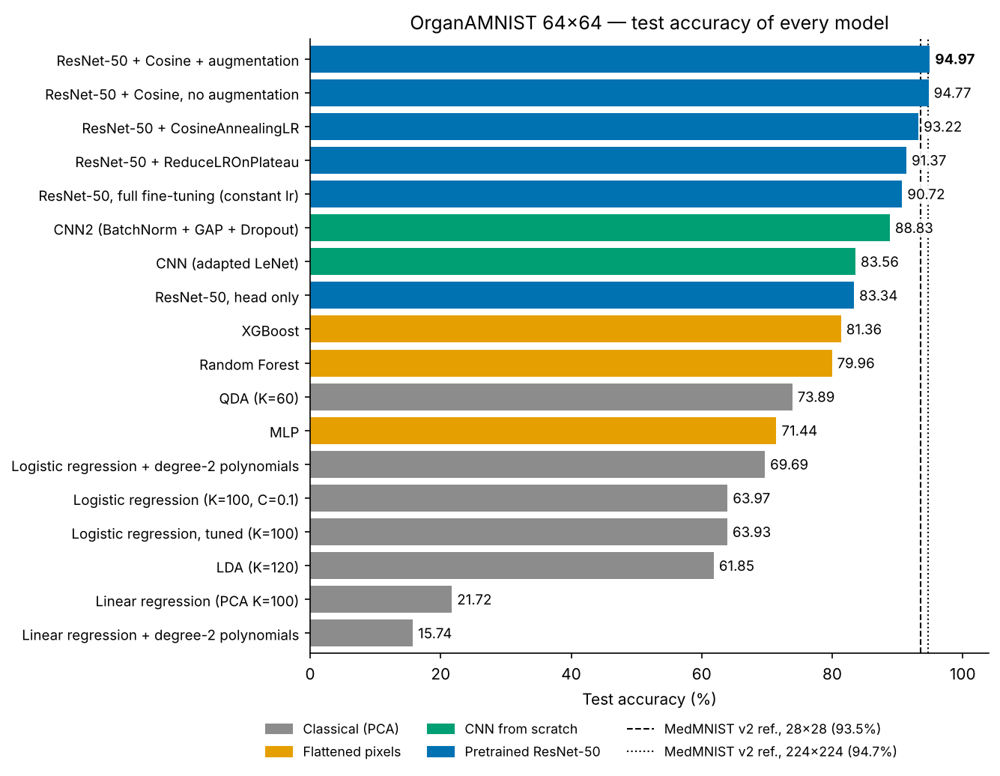
</p>

## Highlights

| | |
|---|---|
| **Best model** | Pretrained ResNet-50 (`timm`), full fine-tuning + cosine learning-rate schedule + rotation/translation augmentation — **94.97 % test accuracy** |
| **Best classical model** | QDA on 60 PCA components — 73.89 % |
| **Best tree ensemble** | XGBoost on raw pixels — 81.36 % |
| **Best CNN from scratch** | 3-block CNN with BatchNorm, GAP and Dropout — 88.83 % |
| **Literature reference** | MedMNIST v2 ResNet-50: 93.5 % (28×28) and 94.7 % (224×224) — *not strictly comparable, see [Limitations](#6-limitations-and-caveats)* |

What the experiments show:

1. **Spatial structure matters most.** Every model that flattens the image into 4,096 independent features plateaus at ≈ 80 % (Random Forest, XGBoost) or lower. Convolutions break through that ceiling.
2. **Pretraining only helps if the whole network is retrained.** ResNet-50 with just the classifier head trained (0.1 % of the weights) reaches 83.3 %, *below* a small CNN trained from scratch. Full fine-tuning gives 90.7 %.
3. **How you train matters as much as what you train.** The same ResNet-50 goes from 90.7 % to 93.2 % just by decaying the learning rate with a cosine schedule.
4. **Data augmentation acts as a regulariser, not an accuracy booster, here.** It more than halves the train–validation gap (1.7 → 0.7 points) but the accuracy gain (+0.2) is smaller than run-to-run noise.
5. **The hard classes are the small, look-alike abdominal organs** (kidneys, spleen, pancreas, bladder). Lungs and liver are easy for every model.

## Contents

1. [Problem](#1-problem)
2. [Dataset](#2-dataset)
3. [Approach](#3-approach)
4. [Results](#4-results)
5. [Design decisions and particularities](#5-design-decisions-and-particularities)
6. [Limitations and caveats](#6-limitations-and-caveats)
7. [Repository structure](#7-repository-structure)
8. [Getting started](#8-getting-started)
9. [Presentation](#9-presentation)
10. [References](#references)

---

## 1. Problem

Each sample is a 2D axial slice of an abdominal/thoracic CT scan, cropped around the bounding box of one organ. The task is **11-way multi-class classification** of the organ.

It is a deceptively hard problem for a 64×64 image:

- **Look-alike organs.** Kidneys, spleen, pancreas and bladder are small soft-tissue structures with similar grey levels.
- **Mirror-image classes.** `femur-left`/`femur-right`, `kidney-left`/`kidney-right` and `lung-left`/`lung-right` are separate classes that differ essentially by a horizontal flip. This forbids the most common augmentation (see [design decisions](#5-design-decisions-and-particularities)).
- **Anatomical variability** across slices of the same organ, and a published benchmark to compare against.

## 2. Dataset

[OrganAMNIST](https://medmnist.com/) (MedMNIST v2 / **MedMNIST+**), 64×64 version. According to the MedMNIST documentation, it is built from CT scans of the Liver Tumor Segmentation Benchmark (LiTS): organ labels come from bounding-box annotations, intensities are mapped to grayscale with an abdominal window, and 2D images are cropped from the centre axial slice of each 3D bounding box.

| Property | Value |
|---|---|
| Task | Multi-class classification (11 organs) |
| Image | 1 channel (grayscale), 64 × 64, `uint8` |
| Split sizes | train 34,561 · validation 6,491 · test 17,778 (58,830 total) |
| Split unit | **CT scan** — 115 / 16 scans for train / val (from the source training set); 70 scans from the source test set for test |
| License | CC BY 4.0 (not intended for clinical use) |

<p align="center">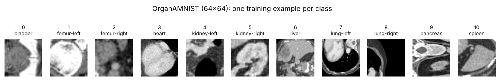</p>

| id | Organ | Train | Val | Test |
|---:|---|---:|---:|---:|
| 0 | bladder | 1,956 | 321 | 1,036 |
| 1 | femur-left | 1,390 | 233 | 784 |
| 2 | femur-right | 1,357 | 225 | 793 |
| 3 | heart | 1,474 | 392 | 785 |
| 4 | kidney-left | 3,963 | 568 | 2,064 |
| 5 | kidney-right | 3,817 | 637 | 1,965 |
| 6 | liver | 6,164 | 1,033 | 3,285 |
| 7 | lung-left | 3,919 | 1,033 | 1,747 |
| 8 | lung-right | 3,929 | 1,009 | 1,813 |
| 9 | pancreas | 3,031 | 529 | 1,622 |
| 10 | spleen | 3,561 | 511 | 1,884 |

<p align="center">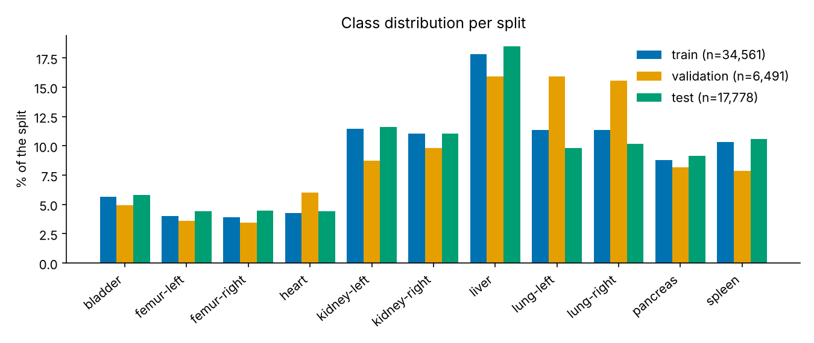</p>

Three properties of the splits are worth knowing before reading any result:

- **Mild class imbalance** (liver ≈ 18 % of train; femurs ≈ 4 % each), so accuracy is complemented by macro-averaged metrics in the scheduler study.
- **The validation split has a different class mix.** Lungs are 31.5 % of validation but only 20.0 % of test. Since lungs are the easiest classes, validation accuracy is inflated relative to test.
- **Splits are made at scan level, and slice-to-scan IDs are not provided.** Slices from the same scan are highly correlated, so random cross-validation *inside* the training set (used for the scikit-learn grid searches) can leak information between folds and is optimistic.

The data file is not stored in the repo (≈ 200 MB); see [Getting started](#8-getting-started).

## 3. Approach

Experiments follow the course's lab sessions (TL01–TL09) and the report structure of TL10. All experiments live in a single notebook, [`notebooks/organamnist_classification.ipynb`](notebooks/organamnist_classification.ipynb) (written in Spanish).

| Notebook § | Stage | Lab | Methods | Key settings |
|---:|---|---|---|---|
| 2 | Data exploration | TL01 | NumPy, Matplotlib | Pixels scaled to [0, 1]; class balance; samples per class |
| 3 | Dimensionality reduction | TL02 | PCA | 4,096 → *K* components; *K* chosen from reconstruction error and accuracy-vs-*K* |
| 4 | Discriminant analysis | TL03 | LDA, QDA | *K* swept 50–400; `reg_param` / `tol` tuned with `RandomizedSearchCV` (log-uniform 1e-4…1e-1) |
| 5 | Logistic regression | TL04 | Grid search, polynomial features | 3-fold CV; degree-2 expansion (~5,000 features) |
| 6 | Linear regression | TL05 | `LinearRegression` | Deliberate negative baseline: labels treated as a continuous target |
| 7 | Neural networks | TL06 | MLP, LeNet-style CNN, CNN2 | AdamW, lr 1e-3, 10 epochs, batch 64 |
| 8 | Transfer learning | TL07 | ResNet-50 via `timm` | Head-only vs. full fine-tuning (batch 64) |
| 9 | LR schedulers | TL08 | `CosineAnnealingLR`, `ReduceLROnPlateau` | Batch size 32, 10 epochs, same initialisation recipe |
| 10 | Data augmentation | TL09 | `torchvision.transforms.v2` | Rotation ±30°, translation ±10 %, **no flips** |
| 11 | Non-parametric models | — | Random Forest, XGBoost | 100 trees each, raw 4,096-pixel vectors |

**Models in detail**

- **PCA-based models** operate on the first *K* principal components of the flattened, [0,1]-scaled image.
- **MLP:** 4096 → 256 → 128 → 11 with ReLU.
- **CNN (adapted LeNet):** two 5×5 conv layers (6 and 16 filters) with 2×2 max-pooling, then dense layers 2704 → 120 → 84 → 11.
- **CNN2:** three conv blocks (3×3; 32/64/128 filters; BatchNorm + ReLU + 2×2 max-pool), global average pooling, Dropout 0.3, one linear layer 128 → 11.
- **ResNet-50:** `resnet50.fb_swsl_ig1b_ft_in1k` from `timm` (23.5 M parameters), created with `in_chans=1` for grayscale input and an 11-class head.

**Evaluation protocol.** Models are trained on the official train split. Hyperparameters are chosen on validation data (neural networks, schedulers) or cross-validation on train (scikit-learn grid searches). The headline metric is **test accuracy**. For the scheduler comparison the study also reports balanced accuracy, macro precision/recall/F1 and one-vs-rest AUC. All neural-network training was done on **CPU**.

## 4. Results

### 4.1 Full comparison

Validation column = last training epoch (neural nets) or mean 3-fold CV on train (scikit-learn grid searches). **Test accuracy is the reliable column** (see [caveats](#6-limitations-and-caveats)).

| Family | Model | Val. acc. (%) | **Test acc. (%)** | Notes |
|---|---|---:|---:|---|
| Classical (PCA) | Linear regression, *K*=100 | — | 21.72 | R² = 0.18 on test |
| | Linear regression + degree-2 polynomials | — | 15.74 | R² = −0.14: overfits badly |
| | LDA, *K*=120 | — | 61.85 | Linear boundaries |
| | Logistic regression, *K*=100, C=0.1 | — | 63.97 | Linear baseline |
| | Logistic regression, tuned | 77.25 (CV) | 63.93 | Tuning gives no gain |
| | Logistic regression + degree-2 polynomials | 98.41 (CV) | 69.69 | Huge CV/test gap |
| | **QDA, *K*=60** | — | **73.89** | `reg_param` = 0.0966 |
| Flattened pixels | MLP | 90.54 | 71.44 | |
| | Random Forest | 95.24 | 79.96 | Trains in 52 s |
| | XGBoost | 94.96 | 81.36 | ≈ 22 min on CPU; macro-F1 0.82 |
| CNN from scratch | CNN (adapted LeNet) | 94.85 | 83.56 | |
| | **CNN2** (BatchNorm + GAP + Dropout) | 93.50 | **88.83** | |
| Pretrained ResNet-50 | Head only (22,539 trainable params) | 91.16 | 83.34 | 15 epochs |
| | Full fine-tuning, constant lr | 98.17 | 90.72 | |
| | + `ReduceLROnPlateau` | 98.00 | 91.37 | |
| | + `CosineAnnealingLR` | 98.01 | 93.22 | |
| | Cosine, no augmentation (re-run) | 98.31 | 94.77 | Same recipe as the row above, different init |
| | **Cosine + augmentation** | 98.40 | **94.97** | Best result |

The same table is available as machine-readable data in [`results/model_comparison.csv`](results/model_comparison.csv).

### 4.2 Classical models on PCA features

PCA concentrates the useful information in a few hundred components: the reconstruction error drops sharply up to *K* ≈ 100–200 and is almost flat beyond ≈ 1,500. With *K* = 100, reconstructions keep the organ's overall shape and contrast but lose internal texture.

<p align="center">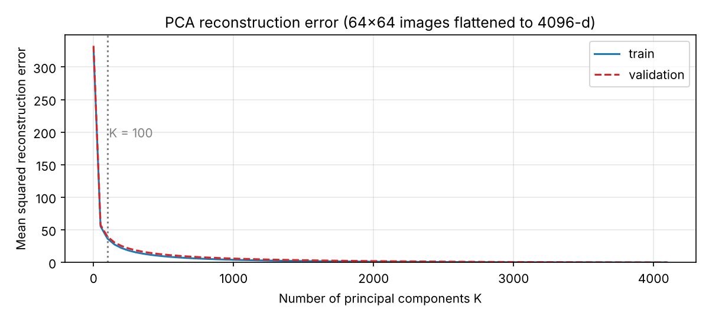</p>
<p align="center">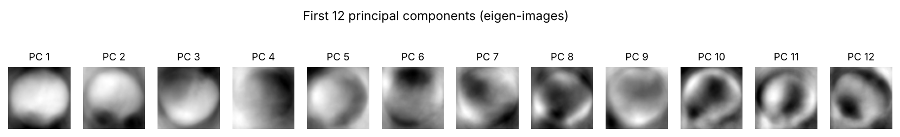</p>
<p align="center">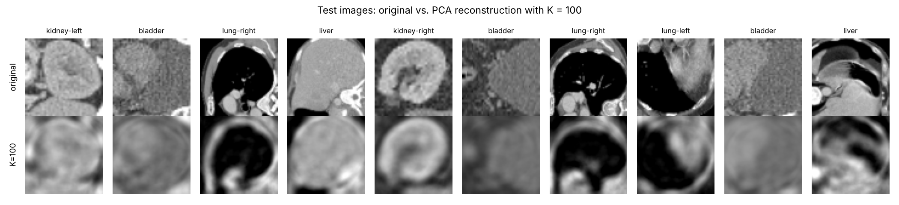</p>

More components do **not** mean better classification. Logistic regression test accuracy peaks at ≈ 64 % around *K* = 100 and then slowly decays to ≈ 60 %, while training accuracy keeps rising: extra components mostly encode training-specific detail. This is why *K* ∈ [50, 200] was adopted as the working range (logistic and linear regression use *K* = 100; the LDA/QDA sweep was widened to 50–400).

<p align="center">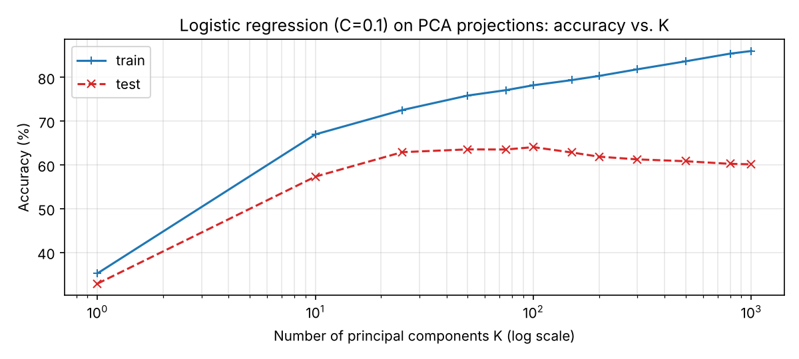</p>

Further findings:

- **QDA (73.89 %) beats LDA (61.85 %).** Each organ has its own covariance structure; QDA's per-class covariance captures it, while LDA's shared covariance forces linear boundaries between classes that overlap non-linearly.
- **Tuning a linear model does not help; making it non-linear does.** Grid-searched logistic regression stays at ≈ 64 %; degree-2 polynomial features reach 69.69 %, though a 98 % CV score against 69.7 % test shows heavy memorisation.
- **Linear regression is the wrong tool**, as intended: it treats organ ids as an ordered continuous quantity (21.7 % accuracy; 15.7 % with polynomials).

**Where do the errors concentrate?** The confusion matrix of the PCA + logistic-regression baseline (64 % overall; figure re-generated by `scripts/make_pca_figures.py`) shows large, high-contrast structures are easy and the small abdominal organs are not:

| Easy | Per-class acc. | Hard | Per-class acc. |
|---|---:|---|---:|
| lung-left | 95.8 % | pancreas | 54.9 % |
| lung-right | 89.0 % | kidney-right | 47.1 % |
| liver | 84.2 % | kidney-left | 47.4 % |
| heart | 73.1 % | spleen | 40.2 % |
| | | bladder | 33.7 % |

Kidneys are confused with each other and with spleen, pancreas and bladder; spleen is most often mistaken for the kidneys. The same difficulty ordering persists in the later models (e.g. XGBoost).

<p align="center">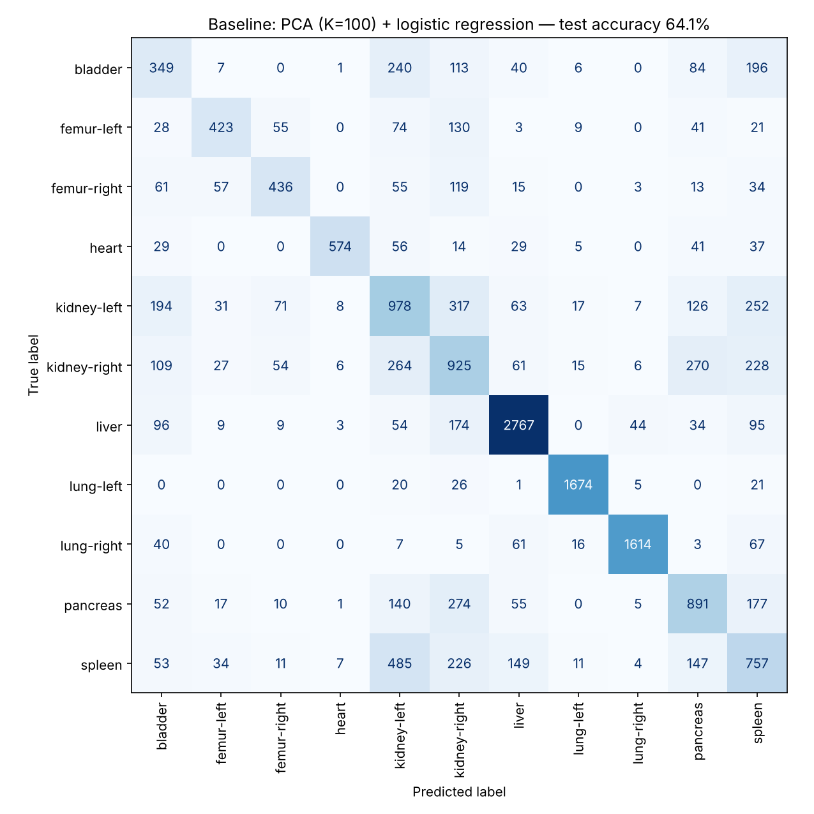</p>

### 4.3 Flattened pixels: MLP, Random Forest, XGBoost

Treating each of the 4,096 pixels as an independent feature, with no spatial inductive bias, gives a ceiling around 80 %:

- **Random Forest 79.96 %** (52 s) and **XGBoost 81.36 %** (≈ 22 min). The extra 1.4 points cost ≈ 25× more training time.
- Both beat PCA-based classical models and the MLP (71.44 %). Compared with the PCA baseline, XGBoost lifts bladder recall from 34 % to 88 % and spleen from 40 % to 71 %, but kidneys remain the weak spot (F1 0.63 left, 0.68 right).
- Per-class precision/recall/F1 for XGBoost: [`results/xgboost_per_class_test.csv`](results/xgboost_per_class_test.csv).

### 4.4 Convolutional networks from scratch

<p align="center">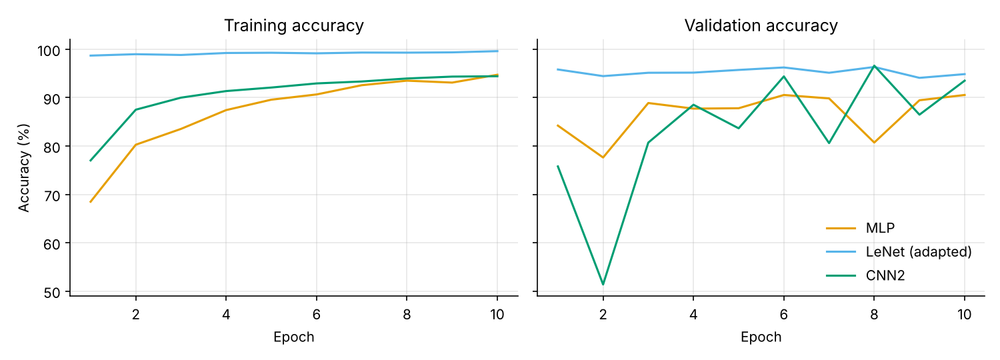</p>

| Model | Test acc. | Behaviour |
|---|---:|---|
| MLP | 71.44 % | Learns slowly; worst generalisation of the three |
| CNN (adapted LeNet) | 83.56 % | Converges fast and stably; ≈ 99 % train accuracy from the first epochs |
| **CNN2** | **88.83 %** | Noisy validation (a dip to 51 % at epoch 2, which the notebook attributes to early BatchNorm/optimisation instability) but the best test result |

Both CNNs clearly beat the MLP and the PCA models: convolutions exploit local spatial structure that flattened-vector models cannot.

### 4.5 Pretrained ResNet-50

<p align="center">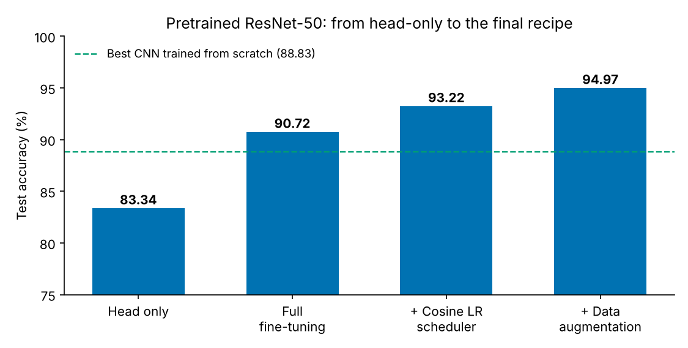</p>

**Transfer learning: head only vs. full fine-tuning.** Training only the 22,539-parameter classifier head reaches 83.34 % — worse than CNN2 trained from scratch. Features learned on colour ImageNet photos do not transfer unchanged to grayscale CT slices; the whole network must be adapted (90.72 %). Full fine-tuning also converges much faster (≈ 97 % validation accuracy by epoch 3).

**Learning-rate schedulers.** With constant lr = 1e-3, validation is unstable early on, which motivated schedulers. Both were trained under identical conditions:

<p align="center">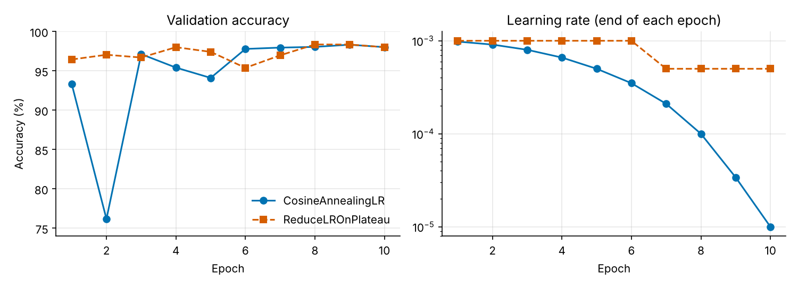</p>

| Test metric | CosineAnnealingLR | ReduceLROnPlateau |
|---|---:|---:|
| Loss | 0.3060 | 0.3905 |
| Accuracy | **93.22 %** | 91.37 % |
| Balanced accuracy | 92.24 % | 90.11 % |
| Macro F1 | 92.58 % | 90.76 % |
| AUC (macro, OvR) | 0.9959 | 0.9954 |

On validation the two are tied (98.01 % vs. 98.00 %), yet on test cosine decay wins on every metric. Cosine anneals lr continuously from 1e-3 to 1e-5; `ReduceLROnPlateau` fired only once in 10 epochs (1e-3 → 5e-4), so it ended with an lr 50× larger. With longer training the gap might shrink (not tested). Both models have higher macro precision than macro recall: they are right when they predict a class but miss some cases, more so with `ReduceLROnPlateau`.

**Data augmentation.** Random rotation (±30°) and translation (±10 %), applied to the training set only:

<p align="center">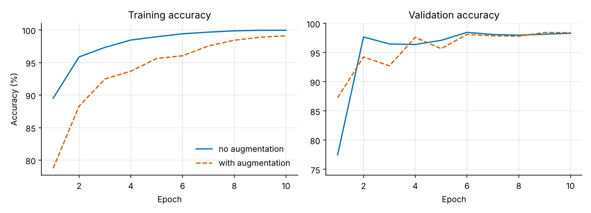</p>

| | No augmentation | With augmentation |
|---|---:|---:|
| Test accuracy | 94.77 % | 94.97 % |
| Final train accuracy | 99.96 % | 99.11 % |
| Train–validation gap | 1.65 pts | 0.71 pts |

The regularising effect is clear in the train–validation gap, but the **+0.2-point test gain is not meaningful**: the identical no-augmentation recipe scored 93.22 % in the scheduler study and 94.77 % here, so run-to-run variation (≈ 1.5 points) is larger than the effect.

### 4.6 Versus the MedMNIST benchmark

The MedMNIST v2 paper reports 93.5 % (28×28) and 94.7 % (224×224) for ResNet-50 on OrganAMNIST. The final 94.97 % is in the same range, **but the comparison is indicative only**: different resolution, preprocessing, training budget and (most importantly here) a single un-seeded run.

## 5. Design decisions and particularities

- **No flips in augmentation.** Left/right organs are separate classes. Mirroring a left kidney produces something that looks like a right kidney but would keep the "left" label, injecting mislabelled samples. Only small rotations and translations are used. Axial CT slices also have a fairly standard orientation, so ±30° may even be unrealistically large, and a smaller range is a natural follow-up.
- **Augmentation only on the training set.** Validation and test are never perturbed.
- **Validation, not test, to pick schedulers.** The scheduler study monitors validation loss and picks the winner on validation, with test evaluated afterwards for reporting.
- **Scheduler stepping.** `CosineAnnealingLR` is stepped **per batch** (`T_max` = total number of optimisation steps); `ReduceLROnPlateau` is stepped **per epoch** with validation loss.
- **Pretrained weights on grayscale.** `timm` with `in_chans=1` adapts the first convolution to a single channel, so no manual 3-channel replication is needed.
- **Two fine-tuning regimes on purpose.** Head-only vs. full fine-tuning quantifies how much ImageNet features transfer to CT, and whether full retraining justifies its compute.
- **Linear regression as a deliberate negative result.** Included to show *why* regression on class ids is inappropriate, with and without feature engineering.
- **QDA regularisation.** Per-class covariances of high-dimensional data are ill-conditioned, so `reg_param` is searched on a log scale (best 0.0966).
- **Cost–accuracy reporting.** Training times are reported next to accuracy (Random Forest 52 s vs. XGBoost ≈ 22 min), because the extra cost buys only ≈ 1.4 points.
- **Metrics beyond accuracy where it matters.** The scheduler comparison adds balanced accuracy, macro P/R/F1 and AUC, which expose weaknesses on harder minority classes.

## 6. Limitations and caveats

Please read these before citing or building on the numbers.

- **Single runs, no fixed random seeds.** Re-running the *same* ResNet-50 + cosine recipe gave 93.22 % and 94.77 %. Differences of about 1–2 points between ResNet-50 variants (cosine vs. no augmentation vs. augmentation) are within noise. Gaps between *families* (e.g. PCA models vs. CNNs vs. pretrained ResNet) are far larger and robust. Averaging over several seeds is the main improvement to make.
- **Test accuracy influenced PCA-model selection.** For logistic regression, LDA and QDA, the best *K* (and the reported best configuration) was picked by looking at test accuracy. Those numbers are therefore slightly optimistic. The neural-network and scheduler experiments select on validation.
- **Cross-validation scores are inflated.** Folds are random over slices, and slices of one scan are correlated (scan IDs are not in the data). This is a plausible contributor to the extreme CV scores (e.g. 98.41 % CV vs. 69.69 % test).
- **Validation ≫ test for every model.** Observed across all models (e.g. ResNet-50: 98.2 % val vs. 90.7 % test). Part of this is the different class mix (lungs, the easiest classes, are over-represented in validation), and the splits come from different scans (test from the source test set). The class mix alone does not explain the whole gap; the rest was not investigated. This is why test accuracy is the comparison metric.
- **Short training budget.** 10 epochs for most networks (15 for head-only), AdamW with lr = 1e-3 and no learning-rate search. No ensembling or test-time augmentation.
- **Reference numbers are not like-for-like** (different resolution and preprocessing).
- **Not for clinical use.** This is an educational/benchmarking project.

## 7. Repository structure

```
.
├── README.md
├── LICENSE
├── requirements.txt
├── notebooks/
│   └── organamnist_classification.ipynb   # all experiments, with outputs (Spanish commentary)
├── data/
│   └── README.md                          # how to get organamnist_64.npz (file is git-ignored)
├── results/
│   ├── model_comparison.csv               # final accuracies of all models
│   ├── training_histories.json            # per-epoch logs parsed from the notebook
│   ├── scheduler_test_metrics.csv         # Cosine vs. ReduceLROnPlateau, full metrics
│   ├── xgboost_per_class_test.csv         # XGBoost precision/recall/F1 per organ
│   └── pca_lr_study.json                  # baseline per-class accuracy + accuracy vs. K
├── assets/                                # figures used in this README
├── scripts/
│   ├── download_data.py                   # fetches the dataset via the medmnist package
│   ├── make_summary_figures.py            # dataset + results figures
│   └── make_pca_figures.py                # PCA / baseline figures
└── docs/
    ├── OrganAMNIST_slides_ES.pptx         # project presentation (Spanish)
    └── OrganAMNIST_slides_ES.pdf          # same, viewable on GitHub
```

## 8. Getting started

**Requirements:** Python 3.10+ (developed on 3.13) and PyTorch ≥ 2.6 (the notebook uses `torch.accelerator`). A GPU is optional: it is used automatically if available, but all reported runs were on CPU.

```bash
git clone https://github.com/<your-username>/organamnist-classification.git
cd organamnist-classification

python -m venv .venv
source .venv/bin/activate            # Windows: .venv\Scripts\activate
pip install -r requirements.txt

python scripts/download_data.py      # -> data/organamnist_64.npz (~200 MB)
jupyter lab notebooks/organamnist_classification.ipynb
```

Run the notebook from its own folder (Jupyter does this by default) because it loads `../data/organamnist_64.npz`. The notebook sections match the *Notebook §* column in [Approach](#3-approach), so you can run the early sections on their own.

**Approximate cost on CPU** (from the notebook): QDA sweep ≈ 12 min, LDA sweep ≈ 13 min, Random Forest ≈ 1 min, XGBoost ≈ 22 min. The ResNet-50 experiments are the most expensive; a GPU speeds them up considerably. Because no seeds are fixed, your numbers will differ slightly from those above.

**Regenerate the README figures**

```bash
python scripts/make_summary_figures.py   # dataset figures + model comparison + training curves
python scripts/make_pca_figures.py       # PCA / baseline figures (a few minutes on CPU)
```

The summary figures read the stored logs in `results/`, so the comparison and training-curve plots do not need retraining. The PCA script recomputes PCA and logistic regressions from the dataset; its numbers closely match the notebook (e.g. baseline 64.06 % vs. 63.97 %, small differences come from float32 arithmetic and the PCA solver).

## 9. Presentation

A five-slide summary of the project (in Spanish) is in [`docs/OrganAMNIST_slides_ES.pdf`](docs/OrganAMNIST_slides_ES.pdf) (PowerPoint source: [`.pptx`](docs/OrganAMNIST_slides_ES.pptx)).

## References

1. J. Yang, R. Shi, D. Wei, Z. Liu, L. Zhao, B. Ke, H. Pfister, B. Ni. **MedMNIST v2 — A large-scale lightweight benchmark for 2D and 3D biomedical image classification.** *Scientific Data* 10, 41 (2023). doi:[10.1038/s41597-022-01721-8](https://doi.org/10.1038/s41597-022-01721-8)
2. J. Yang, R. Shi, B. Ni. **MedMNIST Classification Decathlon: A Lightweight AutoML Benchmark for Medical Image Analysis.** *IEEE ISBI* (2021). doi:[10.1109/ISBI48211.2021.9434062](https://doi.org/10.1109/ISBI48211.2021.9434062)
3. S. Doerrich, F. Di Salvo, J. Brockmann, C. Ledig. **Rethinking model prototyping through the MedMNIST+ dataset collection.** *Scientific Reports* 15, 7669 (2025). doi:[10.1038/s41598-025-92156-9](https://doi.org/10.1038/s41598-025-92156-9)
4. MedMNIST+ data (official distribution): <https://zenodo.org/records/10519652> · project site: <https://medmnist.com/>
5. K. He, X. Zhang, S. Ren, J. Sun. **Deep Residual Learning for Image Recognition.** *CVPR* (2016).
6. I. Z. Yalniz, H. Jégou, K. Chen, M. Paluri, D. Mahajan. **Billion-scale semi-supervised learning for image classification.** arXiv:1905.00546 (2019) — origin of the semi-weakly-supervised ResNet-50 weights used here.
7. R. Wightman. **PyTorch Image Models (`timm`).** <https://github.com/huggingface/pytorch-image-models>
8. T. Chen, C. Guestrin. **XGBoost: A Scalable Tree Boosting System.** *KDD* (2016).
9. F. Pedregosa et al. **Scikit-learn: Machine Learning in Python.** *JMLR* 12 (2011) · [PyTorch](https://pytorch.org/).

## Author and license

**Carlos Broch Cubedo** — project for *Pattern Recognition and Machine Learning* (RFA), 2026/27.

Code is released under the [MIT License](LICENSE). The OrganAMNIST data is under CC BY 4.0 and is not redistributed in this repository; please cite the MedMNIST papers if you use it.
